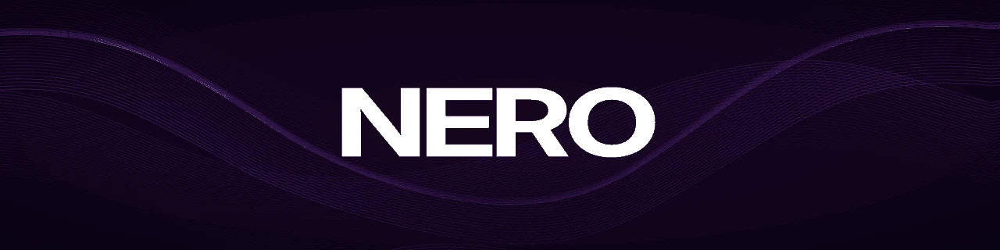
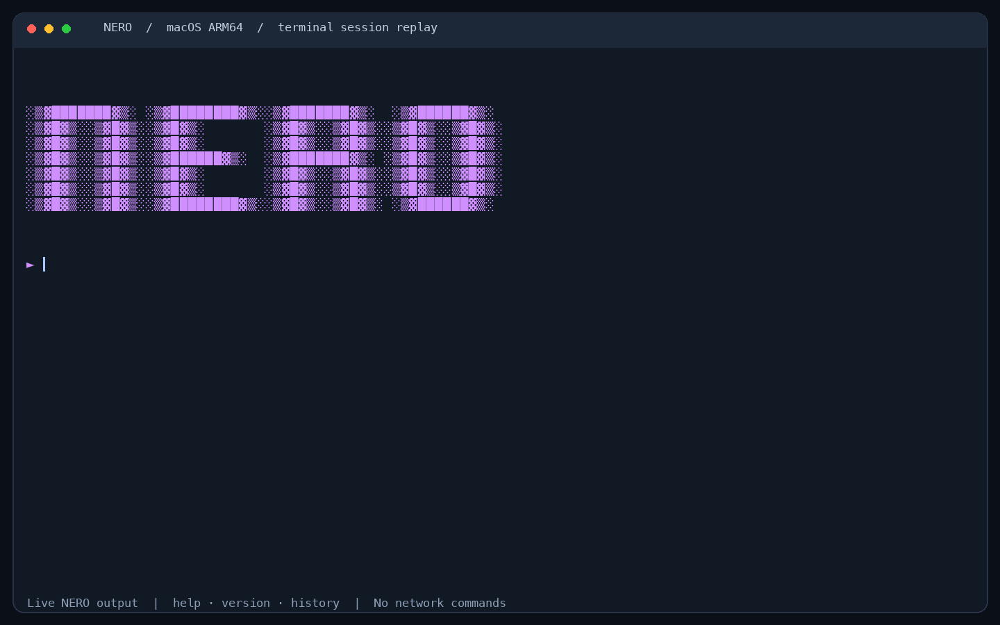

<div align="center">

<h1></h1>

<p><strong>Native C Terminal &amp; Network Research</strong></p>

<p>
  
  
  <a href="LICENSE.txt"></a>
</p>

<p>A native interactive terminal with command history, platform adapters, and experimental network diagnostics, written in C11.</p>

<p>
  <a href="https://github.com/thekiran/nero/releases">Releases</a> ·
  <a href="docs/installation.md">Installation</a> ·
  <a href="docs/command-reference.md">Commands</a> ·
  <a href="docs/README.md">Documentation</a> ·
  <a href="ROADMAP.md">Roadmap</a>
</p>

<a href="https://github.com/user-attachments/assets/270e73c3-a231-474a-a812-7a5dba635084">
  
</a>

</div>

## Overview and Platform Support

NERO provides a unified terminal interface across POSIX and Windows environments. Supported platforms are verified through native automated packaging and CI test runs:

| Platform | Native package / architectures | Verification |
| --- | --- | --- |
| **macOS 15+** | Mach-O 64-bit · ARM64 / x86-64 | Make, CMake, PTY, ASan/UBSan |
| **Ubuntu 24.04+ compatible** | ELF 64-bit · x86-64 / ARM64 | Make, CMake, PTY, ASan/UBSan |
| **Windows 10 / 11** | PE32+ (MinGW UCRT64) · x86-64 | CMake + Ninja, Win32 console/socket CTest |
| **Windows (WSL2)** | Ubuntu Linux package · x86-64 / ARM64 | Standard Linux execution path |

Windows ARM64 has no native package; use WSL2 on ARM64 hardware.

---

## Feature Status

* **Implemented & Verified:**
  * Interactive terminal shell, command tokenization, and line editor (history search, cursor motion, backspace, delete).
  * ANSI VT100 styling with automatic fallback to ASCII when `NO_COLOR=1` or `TERM=dumb`.
  * Network interface enumeration across POSIX (`getifaddrs`) and Windows (`GetAdaptersAddresses`).
  * TCP port diagnostics (`<target> -Sc`) with timeout boundaries.
  * System command installation scripts for `/usr/local/bin` (macOS/Linux) and `%LOCALAPPDATA%\Programs\Nero\bin` (Windows).
* **Experimental Modules (Authorized Laboratory Use Only):**
  * Raw packet engine (`<target> -Syn`) on Linux and macOS. Requires administrative root elevation (`sudo nero`) for `SOCK_RAW` and BPF access.
* **Unavailable Features:**
  * Raw packet engine (`-Syn`) on Windows: user-space raw TCP injection is restricted by the Windows desktop network stack. The command reports unsupported without transmitting traffic.
* **Planned Features:**
  * Authenticode and Apple Developer ID signing certificates (tracked in [ROADMAP.md](ROADMAP.md)).
  * Distribution via package managers (Homebrew, APT).

---

## Quick Installation

Download the package matching your operating system from [GitHub Releases](https://github.com/thekiran/nero/releases) and verify its `.sha256` checksum before installing. If no release has been published yet, follow the [source-build instructions](docs/installation.md).

### macOS & Linux

```bash
# Replace the version and platform with the package you downloaded.
PACKAGE="nero-vX.Y.Z-macos-arm64"  # e.g. linux-x86_64 for Linux
tar -xzf "$PACKAGE.tar.gz"
sudo sh "$PACKAGE/install.sh"
nero
```

### Windows (Native PowerShell)

```powershell
# Replace X.Y.Z with the downloaded release version.
$package = "nero-vX.Y.Z-windows-x86_64"
Expand-Archive -Path "$package.zip" -DestinationPath . -Force
& ".\$package\install.ps1"

# The installer updates the current session PATH.
nero
```

For complete step-by-step instructions, checksum validation, dependencies, and building from source, see the **[Installation Guide](docs/installation.md)**.

---

## Usage Example

<details>
<summary>Watch a recorded native terminal demo (GIF)</summary>

<p align="center"></p>

Recorded from a native macOS ARM64 PTY session; this is an earlier-build
terminal demonstration, not a live scanner or raw-packet test.
See [the recording notes](docs/media/README.md) for reproduction details.

</details>

Launch the interactive shell:

```text
$ nero

░▒▓███████▓▒░ ░▒▓████████▓▒░░▒▓███████▓▒░  ░▒▓██████▓▒░
░▒▓█▓▒░░▒▓█▓▒░░▒▓█▓▒░       ░▒▓█▓▒░░▒▓█▓▒░░▒▓█▓▒░░▒▓█▓▒░
░▒▓█▓▒░░▒▓█▓▒░░▒▓██████▓▒░  ░▒▓███████▓▒░ ░▒▓█▓▒░░▒▓█▓▒░
░▒▓█▓▒░░▒▓█▓▒░░▒▓█▓▒░       ░▒▓█▓▒░░▒▓█▓▒░░▒▓█▓▒░░▒▓█▓▒░
░▒▓█▓▒░░▒▓█▓▒░░▒▓████████▓▒░░▒▓█▓▒░░▒▓█▓▒░ ░▒▓██████▓▒░

► help
Available Commands:
  help                 : Show this help message
  version              : Show program version
  history              : Show command history
  history -clear       : Clear command history
  clear                : Clear the screen
  exit                 : Quit the shell
  <target> -Sc         : Check TCP ports (offline builds simulate)
  -mode [on|off]       : Configure network diagnostics

► version
version 1.0

► exit
Exiting...
```

You can also pipe commands into standard input:

```bash
printf "version\nhelp\nexit\n" | nero
```

See the **[Command Reference](docs/command-reference.md)** for syntax, parameter options, and execution constraints.

---

## Testing and Quality Assurance

All automated CI workflows run strictly in **offline-safe** mode: tests do not generate unsolicited packets or contact external servers.

```bash
# macOS / Linux (Make)
make test             # Core regressions and terminal PTY tests
make test-sanitize    # AddressSanitizer and UndefinedBehaviorSanitizer

# CMake cross-platform presets
cmake --preset <macos|linux|windows>
cmake --build --preset <macos|linux|windows>
ctest --preset <macos|linux|windows> --output-on-failure
```

Detailed test architectures, mock fixtures, and Win32 loopback tests are documented in **[Testing and QA](docs/testing.md)**.

---

## Documentation Library

* **[Documentation Hub](docs/README.md):** Complete index of technical guides and review history.
* **[GitHub Wiki](https://github.com/thekiran/nero/wiki):** Automated mirror of all project documentation.
* **[Architecture](docs/architecture.md):** Modular design, header contracts, and build boundaries.
* **[Building & Toolchains](docs/building.md):** Make and CMake presets, compilers, and code formatting.
* **[Troubleshooting](docs/troubleshooting.md):** Solutions for shell PATH overflows, terminal resets, and build issues.
* **[Contributing](CONTRIBUTING.md):** Pull request expectations, review criteria, and safety agreements.
* **[Security Policy](SECURITY.md):** Responsible reporting and vulnerability disclosure.
* **[Roadmap](ROADMAP.md):** Milestone targets and release criteria.

---

## Security Notice

NERO is experimental software intended exclusively for isolated laboratories and explicitly authorized testing. Do not use experimental network modules on untrusted networks or without authorization. See [SECURITY.md](SECURITY.md) and [Laboratory Safety](docs/laboratory-safety.md).

Green CI runs verify offline behavior and package integrity; they do not imply certification for production security environments.

---

[Demonstration Video](https://www.youtube.com/watch?v=2HGtMkmqwpU) · [Report an Issue](https://github.com/thekiran/nero/issues/new/choose) · [Changelog](CHANGELOG.md)

Distributed under the [MIT License](LICENSE.txt).
Copyright © 2025–2026 Muhammed Emin Kıran.
