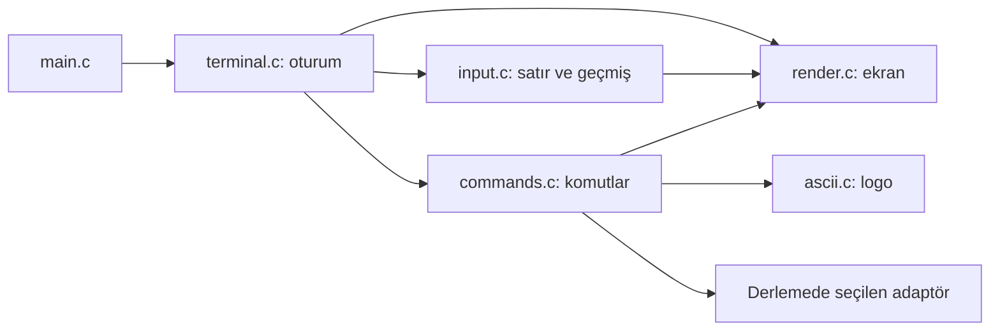

# Kod haritası

[Proje ana sayfası](../README.md) · [Belgeler](README.md) · [Derleme](building.md)

## Hangi dosyayı açmalıyım?

| Değiştirmek istediğim şey | Dosya | Bakılacak sembol |
| --- | --- | --- |
| Uygulamanın başlangıcı | [src/main.c](../src/main.c) | `main` |
| Terminalin açılışı ve kapanışı | [terminal.c](../src/cli/terminal.c) | `terminal_code`, `terminal_cleanup` |
| Sinyaller ve terminal ayarları | [terminal.c](../src/cli/terminal.c) | `cli_signal_mode`, `disableBuffering` |
| Klavyeden giriş ve satır düzenleme | [input.c](../src/cli/input.c) | `cli_read_line`, `escape_key` |
| Komut geçmişi ve ok tuşları | [input.c](../src/cli/input.c) | `cli_history_add`, `cli_read_line` |
| Komut tanıma ve parametre kontrolü | [commands.c](../src/cli/commands.c) | `cli_dispatch_command` |
| Yardım metni ve ekran çizimi | [render.c](../src/cli/render.c) | `cli_show_help`, `cli_render_line` |
| Renk, ANSI ve Unicode seçimi | [render.c](../src/cli/render.c) | `terminal_*_enabled` |
| Logo ve animasyon kareleri | [ascii.c](../src/cli/ascii.c) | `ascii_function`, `windows` |
| CLI iç veri tipleri ve sözleşmeleri | [cli_internal.h](../src/cli/cli_internal.h) | `cli_line`, `CLI_*` |
| Kullanılan yazdırma sabitleri | [printing.h](../include/nero/printing.h) | Mesaj ve tablo makroları |
| İşletim sistemi / mimari bilgisi | [platform.c](../src/core/platform.c) | `nero/platform.h` API uygulaması |
| Bağımsız platform raporu | [platform_info.c](../src/modules/platform_info.c) | `main` |
| macOS yerel arayüz listesi | [select_interface_macos.c](../src/platform/macos/select_interface_macos.c) | `list_and_select_interface` |
| Linux yerel arayüz listesi | [select_interface.c](../src/platform/linux/select_interface.c) | `list_and_select_interface` |
| Ağ özelliğinin kapalı olduğu adaptör | [network_unavailable.c](../src/platform/macos/network_unavailable.c) | `SYN_Flood` yerine kullanılan stub |
| Make hedefleri ve kaynak seçimi | [Makefile](../Makefile) | `CLI_SOURCES`, `SAFE_SOURCES`, `test` |
| CMake hedefleri ve derleyici ayarları | [CMakeLists.txt](../CMakeLists.txt), [NeroTargets.cmake](../cmake/NeroTargets.cmake) | `nero_target` |

## CLI okuma sırası

1. `src/main.c` → `terminal_code()` çağrısını bulun.
2. `terminal.c` → oturum kurulumu, ana döngü ve temizliği okuyun.
3. `input.c` → tuşların bir komut satırına nasıl dönüştüğünü izleyin.
4. `commands.c` → satırın nasıl ayrıştırılıp yönlendirildiğini okuyun.
5. `render.c` ve `ascii.c` → çıktı ve görünümü inceleyin.

## Sorumluluk sınırları

- `terminal.c` oturumun sahibidir: sinyal ve terminal ayarlarını geri yükler.
- `input.c` komut metnini, imleci ve geçmiş yazımlarını yönetir; komut çalıştırmaz.
- `render.c` giriş tamponunu değiştirmeden ekranı çizer.
- `commands.c` parametreleri doğrular ve mevcut davranışa yönlendirir.
- `cli_internal.h` uygulama dışına açılmaz; ortak CLI tiplerini tek yerde tutar.
- `include/nero/` dış bileşenlerin kullandığı başlıklardır.
- `third_party/` proje biçimlendirmesine ve CLI refaktörlerine dahil edilmez.

`history`, `row_location`, `ekran_mutex` gibi mevcut semboller uyumluluk için
korunmuştur. Yeni ortak durum eklerken sahipliği açıkça belirtin.

## Testlerde ne nerede?

| Alan | Dosya / klasör |
| --- | --- |
| Temel CLI ve arayüz regresyonları | [test_safe.py](../tests/test_safe.py) |
| Satır düzenleme, sinyaller, PTY ve sınır durumları | [test_terminal_quality.py](../tests/test_terminal_quality.py) |
| Terminal hatalarının enjeksiyonu | [terminal_faults.c](../tests/mocks/terminal_faults.c) |
| Ağ çağrısı yerine kayıt üreten mock | [network_handler.c](../tests/mocks/network_handler.c) |
| Adaptör birim testi | [tests/unit/](../tests/unit/) |
| Platform raporu ve kaynak bütünlüğü | [test_foundation.py](../tests/integration/test_foundation.py) |

## Eski ve özel dosyalar

- `src/cli/printing.c`: kullanılmayan eski makro kopyasıdır; derlenmez.
  Görünüm değişikliklerini `include/nero/printing.h` veya `render.c` içinde yapın.
- `src/modules/syn_flood_powered.c` ve `portscanner.c`: mevcut Linux modülleridir;
  CLI düzenleme çalışması kapsamındaki testlere bağlanmazlar.
- `src/platform/macos/network_unavailable.c`: adına rağmen taşınabilir bir stub'dır;
  diğer platformlardaki çevrimdışı testler de kullanır.
- `src/platform/windows/`: ayrılmış dizindir; Windows terminal uygulaması yoktur.
- `tests/baseline.json` ve ilgili manifestler: tarihsel ve onaylı değişiklik kayıtlarıdır;
  normal çalışma zamanı verisi değildir.
