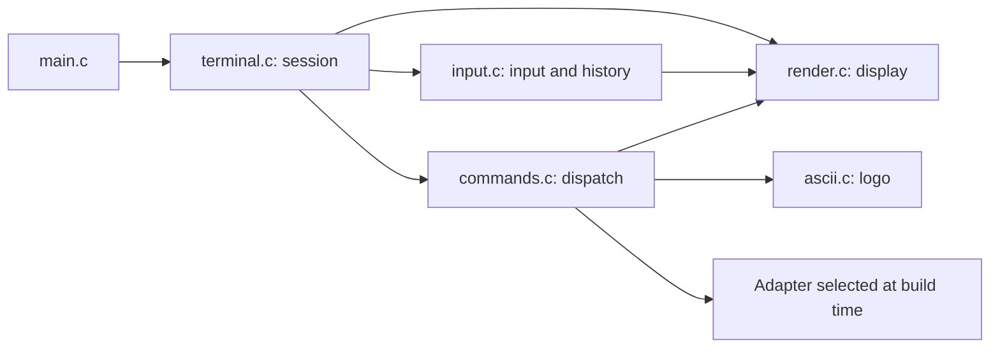

# Code map

[Project home](../README.md) · [Documentation](README.md) · [Build guide](building.md)

## Which file should I open?

| Responsibility | File | Starting symbol |
| --- | --- | --- |
| Application startup | [src/main.c](../src/main.c) | `main` |
| Terminal startup and shutdown | [terminal.c](../src/cli/terminal.c) | `terminal_code`, `terminal_cleanup` |
| Signals and terminal settings | [terminal.c](../src/cli/terminal.c) | `cli_signal_mode`, `disableBuffering` |
| Keyboard input and line editing | [input.c](../src/cli/input.c) | `cli_read_line`, `escape_key` |
| Command history and arrow keys | [input.c](../src/cli/input.c) | `cli_history_add`, `cli_read_line` |
| Command recognition and argument validation | [commands.c](../src/cli/commands.c) | `cli_dispatch_command` |
| Help text and display rendering | [render.c](../src/cli/render.c) | `cli_show_help`, `cli_render_line` |
| Color, ANSI and Unicode capabilities | [render.c](../src/cli/render.c) | `terminal_*_enabled` |
| Logo and animation frames | [ascii.c](../src/cli/ascii.c) | `ascii_function`, `windows` |
| Private CLI types and contracts | [cli_internal.h](../src/cli/cli_internal.h) | `cli_line`, `CLI_*` |
| Active presentation constants | [printing.h](../include/nero/printing.h) | Message and table macros |
| Operating system / architecture information | [platform.c](../src/core/platform.c) | `nero/platform.h` API implementation |
| Standalone platform report | [platform_info.c](../src/modules/platform_info.c) | `main` |
| Local macOS interface listing | [select_interface_macos.c](../src/platform/macos/select_interface_macos.c) | `list_and_select_interface` |
| Local Linux interface listing | [select_interface.c](../src/platform/linux/select_interface.c) | `list_and_select_interface` |
| Disabled-network command | [commands.c](../src/cli/commands.c) | `NERO_NETWORK_UNAVAILABLE` |
| Make targets and source selection | [Makefile](../Makefile) | `CLI_SOURCES`, `SAFE_SOURCES`, `test` |
| CMake targets and compiler settings | [CMakeLists.txt](../CMakeLists.txt), [NeroTargets.cmake](../cmake/NeroTargets.cmake) | `nero_target` |

## Suggested CLI reading order

1. `src/main.c`: find the call to `terminal_code()`.
2. `terminal.c`: follow session setup, the main loop and cleanup.
3. `input.c`: trace how key presses become a command line.
4. `commands.c`: follow command parsing and dispatch.
5. `render.c` and `ascii.c`: inspect presentation and visual output.

## Responsibility boundaries

- `terminal.c` owns the session and restores signal handlers and terminal settings.
- `input.c` manages command text, cursor state and history writes; it does not execute commands.
- `render.c` draws the display without modifying the input buffer.
- `commands.c` validates arguments and dispatches existing behavior.
- `cli_internal.h` holds private CLI types and contracts; it is not a public API.
- `include/nero/` contains headers used by external components.
- `third_party/` is excluded from project formatting and CLI refactoring.

Existing symbols such as `history`, `row_location` and `ekran_mutex` are retained
for compatibility. Document ownership when introducing shared state.

## Test locations

| Area | File / directory |
| --- | --- |
| Core CLI and interface regression tests | [test_safe.py](../tests/test_safe.py) |
| Line editing, signals, PTY and boundary cases | [test_terminal_quality.py](../tests/test_terminal_quality.py) |
| Terminal fault injection | [terminal_faults.c](../tests/mocks/terminal_faults.c) |
| Logging mock for network calls | [network_handler.c](../tests/mocks/network_handler.c) |
| Platform report and source integrity | [test_foundation.py](../tests/integration/test_foundation.py) |

## Legacy and special-purpose files

- `src/cli/printing.c` is an unused legacy macro copy; it is not compiled.
  Make presentation changes in `include/nero/printing.h` or `render.c`.
- `src/modules/syn_flood_powered.c` and `portscanner.c` are existing Linux modules;
  they are not linked into CLI development tests.
- Offline CLI builds report network unavailability directly in `commands.c`.
- `src/platform/windows/` is reserved; no Windows terminal implementation exists.
- `tests/baseline.json` and related manifests record historical and intentional
  changes; they are not runtime data.
